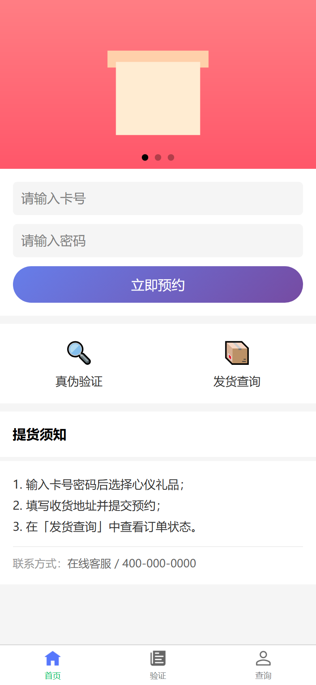
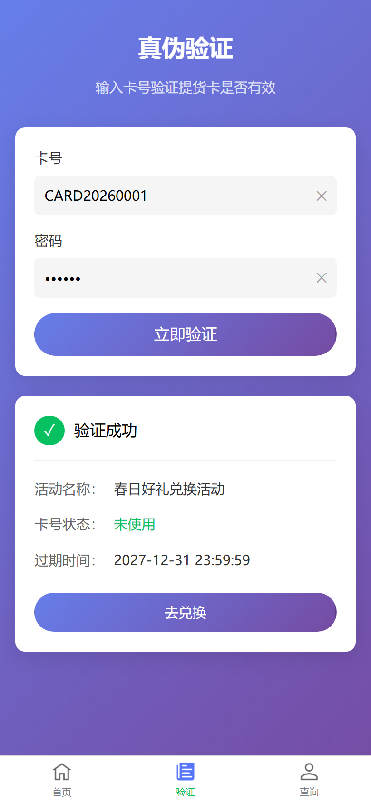
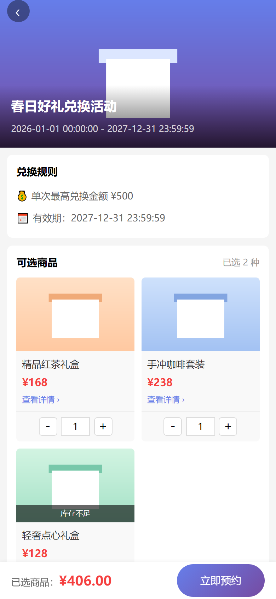
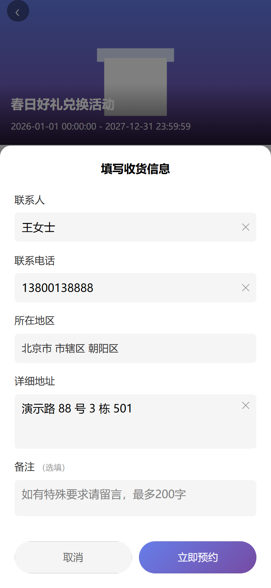
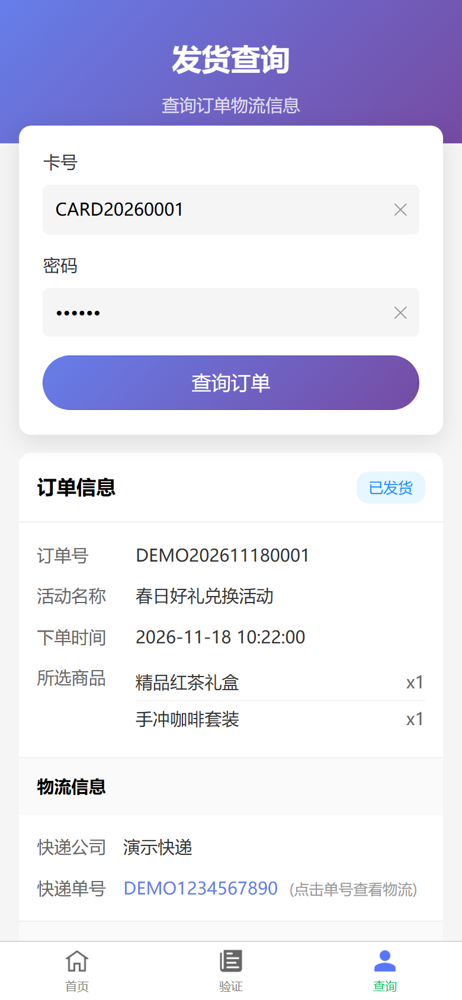
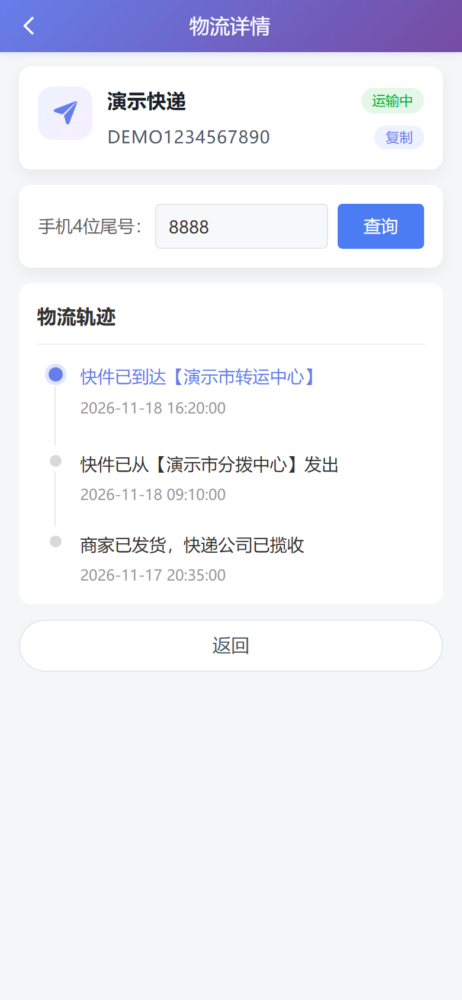

# 提货卡用户端（UniApp）

> 持卡人兑换礼品的移动端：输入卡号密码 → 验证真伪 → 选商品填地址 → 查询发货 → 看物流轨迹。
> Vue3 + UniApp + Vite，**内置 mock 数据，不接后端即可完整跑通**。


---

## 为什么开源这个端

大多数提货卡系统把「用户端」藏在后台演示账号后面，外人看不到真实体验。这个仓库只开放**持卡人侧**的完整交互，把管理后台、卡密生成、订单履约、多租户计费全部留在商业版里。

对开发者：一个能直接跑的 UniApp 业务模板，含富文本、省市区联动、支付/物流类页面常见的键盘避让处理。
对商家：先看用户用起来顺不顺，再决定要不要整套系统。

视频讲解 @抖音「阿龙做系统落地」，深度教程 @公众号「soft零壹零」。

## 快速开始

```bash
npm install
npm run dev:h5
```

浏览器打开 `http://localhost:9527`。

微信小程序：`npm run dev:mp-weixin`，用 HBuilderX 或微信开发者工具打开 `dist/dev/mp-weixin`。

生产构建：`npm run build:h5`。

默认开启 mock 模式，**不需要数据库、不需要 PHP 后端、不需要租户账号**。

### 演示卡号

| 卡号 | 密码 |
|---|---|
| `CARD20260001` | `888888` |

首页输入这两项 → 点「立即预约」进入活动页；也可在「验证」页验证后点「去兑换」。选两件商品、填收货信息提交，再切到「查询」页就能看到订单和物流。

## 页面一览

| 页面 | 路径 | 说明 |
|---|---|---|
| 首页 | `pages/gift/index` | 轮播、卡号密码入口、提货须知、真伪验证/发货查询 |
| 真伪验证 | `pages/gift/verify` | 校验卡号密码，展示卡状态与关联活动 |
| 活动选品 | `pages/gift/activity` | 活动规则、商品列表、数量/金额限制、收货信息弹窗 |
| 商品详情 | `pages/gift/goods-detail` | 富文本详情与图集，支持隐藏商品价格 |
| 发货查询 | `pages/gift/query` | 按卡号密码查订单、商品明细、快递单号 |
| 物流详情 | `pages/gift/express-detail` | 物流轨迹时间线；顺丰要求手机后 4 位 |








## 接入自己的后端

改 `.env.development` / `.env.production`：

```ini
VITE_USE_MOCK = false
VITE_APP_BASE_URL = https://your-api.example.com
VITE_APP_PROXY_PREFIX = /api
VITE_APP_OPEN_PROXY = false
VITE_TENANT_CODE = YOUR_TENANT
```

请求层在 `src/utils/request.js`：统一注入 `Authorization` 和 `X-Tenant-Code`，并处理 401 跳转。租户编码支持三种入口：URL 参数 `?tenant=xxx`、小程序启动参数、`.env` 兜底。

接口清单在 `src/api/gift.js`（提货卡业务）和 `src/api/common/`（站点、用户、CMS）。mock 实现的字段结构可直接作为后端返回契约参考。

## 目录结构

```
src/
├── api/            # 接口封装
├── mock/           # 本地演示数据（仅 mock 模式加载）
├── pages/gift/     # 持卡人主流程
├── pages/common/   # 登录、注册、协议、个人中心
├── stores/         # Pinia：站点配置与用户状态
├── utils/          # 请求封装、校验
├── uni_modules/    # uni-icons、z-paging
└── static/images/  # 演示图与 tabbar 图标
```

## 几个实现细节

- **收货弹窗键盘避让**：H5 用 `visualViewport` 推算键盘高度并动态收缩弹窗；小程序用 `onKeyboardHeightChange`。聚焦字段会滚动到可视区，避免最后一项被挡住。
- **省市区三列联动**：`mode="multiSelector"`，按 `parent_id` 懒加载并缓存，H5 不依赖 `picker mode="region"` 的数据源。
- **活动隐藏价格**：`hide_price=1` 时商品页、活动页、合计金额统一改为展示件数，但下单金额校验照常执行。
- **顺丰尾号拦截**：快递编码为 `SF` 时，未填 4 位尾号不发请求，避免白扣物流查询配额。
- **小程序 button 圆角**：全局重置 `button::after`，解决原生伪元素造成的毛边。

## 开源版 vs 商业版

| 能力 | 本仓库 | 完整系统 |
|---|---|---|
| 持卡人端 H5 / 小程序 | ✅ | ✅ |
| 本地演示数据 | ✅ | — |
| 卡密生成、导入、回收 | — | ✅ |
| 礼包活动与商品管理 | — | ✅ |
| 订单履约、发货、短信通知 | — | ✅ |
| 物流 API 对接与配额计费 | — | ✅ |
| 多租户套餐、支付、权限 | — | ✅ |

需要完整方案（管理后台 + 后端 + 部署）可加微信 `softzero100` 聊；也欢迎在 Issue 里提前端问题。

## License

MIT © 2026 alongluodi
